# TaskPal user guide

TaskPal is a picture checklist for your child's daily routines. It runs on an M5Paper e-ink tablet: the screen looks like paper, uses no backlight, and keeps its picture even while the device sleeps. Your child taps tasks as they finish them; you set up the lists in a parent area protected by a PIN.

This guide covers the child's screens first, then the parent area, then charging and troubleshooting. All screenshots were taken from a real device.

**Contents:** [1. The device](#1-the-device) · [2. For your child](#2-for-your-child) · [3. Stars](#3-stars) · [4. Sleep and wake](#4-sleep-and-wake) · [5. The parent area](#5-the-parent-area) · [6. Editing a list](#6-editing-a-list) · [7. Device settings](#7-device-settings) · [8. Battery and charging](#8-battery-and-charging) · [9. Troubleshooting](#9-troubleshooting)

---

## 1. The device
- **Screen:** touch it with a finger. E-ink changes are not instant: a tap shows up within about a quarter of a second, and a whole new screen flashes black and white once while it redraws. That flash is normal.
- **Side button** (the small rocker on the right edge): push it **in** to switch the device on or wake it up.
- **Reset button** (small, on the back): restarts the device. You only need it for the forgotten-PIN recovery (§5).
- **USB-C:** charging, and installing new versions of TaskPal (see the [README](../README.md)).

---

## 2. For your child

### Pick a list
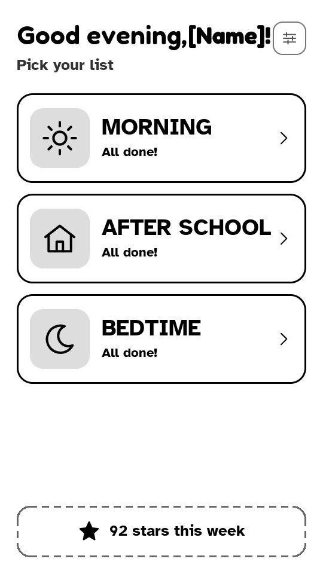

This is the home screen.

- **Greeting** at the top: "Good morning / afternoon / evening", with your child's name if you entered one.
- **One card per list**, with its picture and how far along it is ("2 of 6 done", "All done!").
- **NOW:** the list whose time window is happening right now (for example Morning, 6:30–8:30) stands out with a thicker border, a black picture tile, a black **NOW** label and a progress bar, so your child knows which one to do. Lists set to "Any time" never show NOW.
- **Stars this week** at the bottom: every task checked this week earns a star (§3). You can hide this in Device settings.
- **Gear** (top right): the way into the parent area. A quick tap does nothing; it has to be held for 3 seconds (§5).

Tap a card to open the list.

 

### A checklist
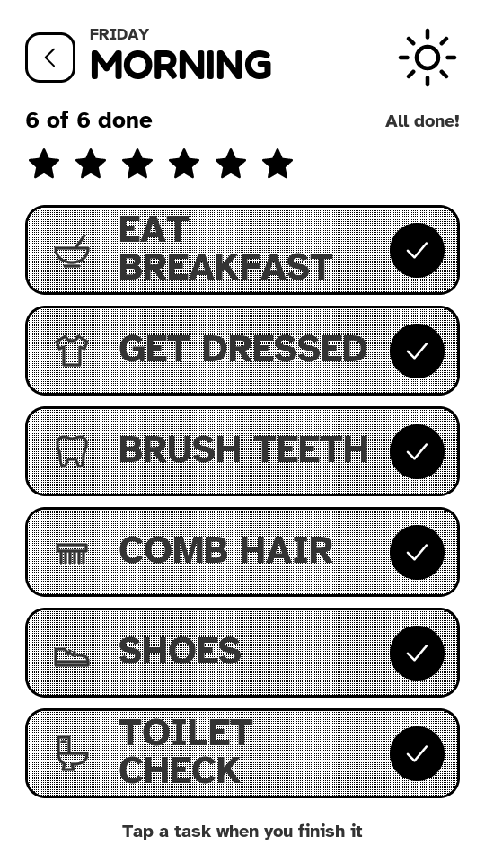

- The header shows the day, the list name and picture, "**4 of 6 done**", and one star per task that fills in as tasks are checked.
- **Tap a task when it's finished.** The row flashes, a big check mark stamps onto it with little rays, then it settles into a gray "done" row with a black check circle.
- **Tapped by mistake?** Tap the row again to uncheck it. That takes its star back.
- Quick double taps on the same row count once. Taps on other rows during an animation are not lost; they play one after another.
- **Back arrow** (top left): returns to Pick a list.

 

### All done!

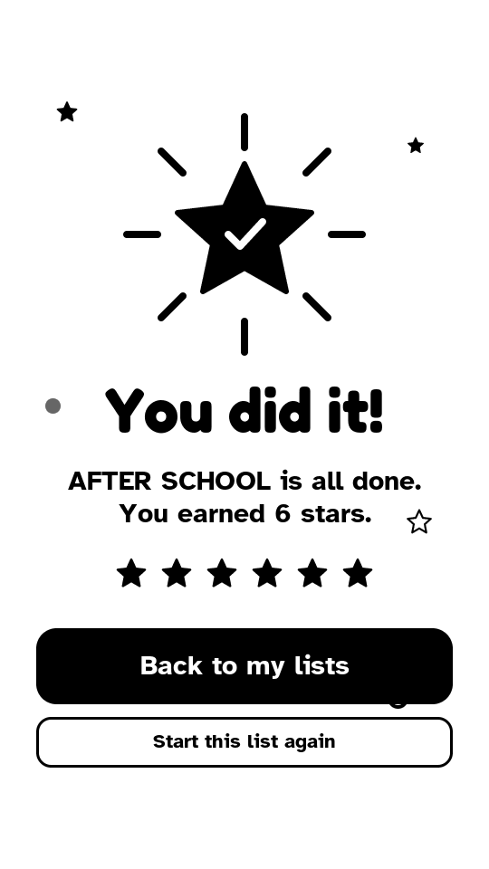
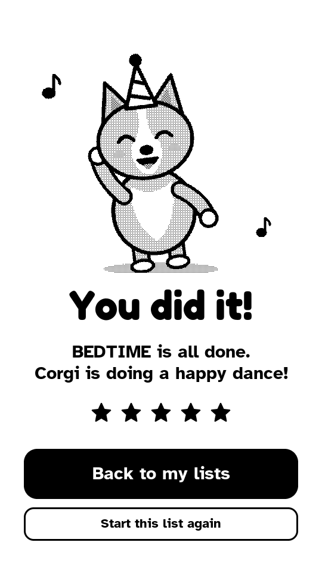
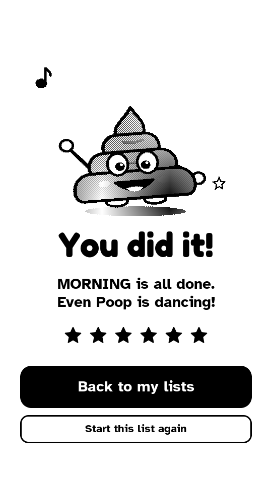

When the last task is checked, the screen goes black for a moment, then the celebration appears and dances a few times before it stops (to save battery). Each list can have its own celebration: the **star**, a **dancing corgi** or a **dancing poop** (chosen in Edit list, §6).

- **Back to my lists** returns to Pick a list.
- **Start this list again** unchecks every task in this list so it can be done again. The stars for those tasks are taken back, and re-checking them earns them again.

### Every morning
At the **reset hour** (4:00 by default; you can change it in Device settings) all lists start fresh: every task is unchecked. The stars already earned are kept.

---

## 3. Stars
- Each task checked today earns **one star**.
- Unchecking a task, or using "Start this list again", takes that star back, even after the celebration. This stops stars from piling up when a list is completed by accident.
- After the reset hour, the checks are cleared but the stars stay. Yesterday's stars can't be taken back.
- The weekly total starts at 0 every **Monday**.

---

## 4. Sleep and wake
To make the battery last, TaskPal sleeps when nobody is using it. The last picture stays on the screen while it sleeps.

| After | What happens | To wake it |
|---|---|---|
| 2 minutes without a touch | Light sleep | Tap the screen or push the side button: back in about 1.5 s, on the same screen |
| 30 more minutes | Deep sleep | Tap the screen or push the side button: back in a few seconds, on the same list |

- The tap that wakes the device doesn't also check a task.
- **The screen keeps itself up to date while asleep:** when a list's time window starts or ends (the NOW label moves) or the greeting changes (at noon and 6 pm), the device wakes for a moment, redraws Pick a list and goes back to sleep. You can switch this off in Device settings.
- At the reset hour it also wakes briefly to start the new day (and to set its clock over WiFi, if WiFi is set up).

---

## 5. The parent area

### Getting in
1. On Pick a list, **press and hold the gear for 3 seconds.** A ring grows around it; keep holding until it's complete.
2. **The PIN screen opens.** The very first time, it asks you to **create** a 4-digit PIN and then enter it again. After that, enter your PIN.

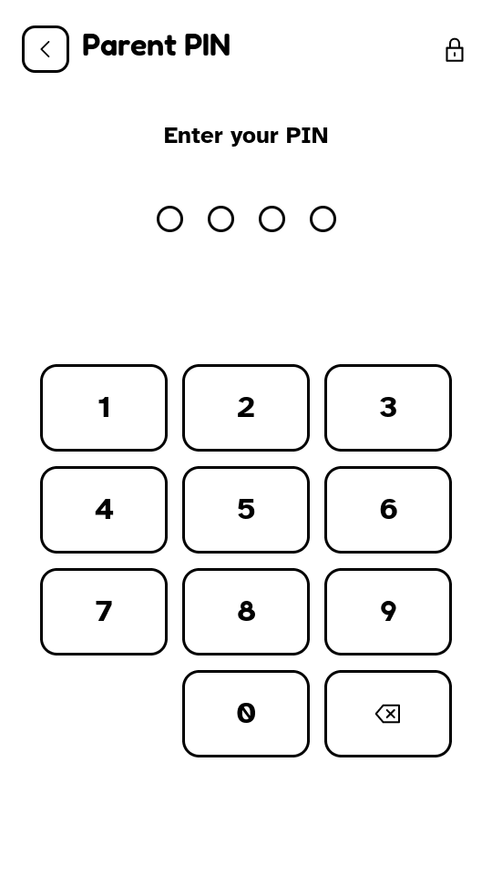

- After **5 wrong PINs**, entry is locked for **60 seconds**.
- The parent area closes by itself after **2 minutes** without a touch, and whenever the device goes to sleep. You'll need the PIN again next time.

**Forgot the PIN?** Hold the **side button pushed in**, press the **reset button on the back**, and keep holding the side button. The screen asks "Reset parent PIN?"; keep holding for 10 seconds until it says "PIN reset". Lists, progress and stars are kept; you create a new PIN the next time you enter the parent area.

### Parent settings
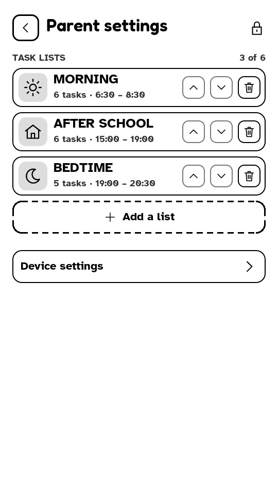

The list of lists (up to **6**):

- **Tap a list** to edit it (§6).
- **Up / down arrows** change the order (also the order on Pick a list).
- **Trash** deletes a list, after asking you to confirm.
- **Add a list** creates a new one and opens it for editing.
- **Device settings** opens the device options (§7).
- **Back arrow** returns to your child's screens.

 

---

## 6. Editing a list
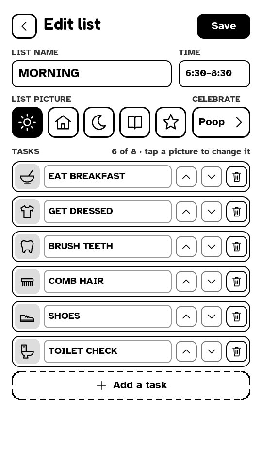

Changes are only kept when you press **Save**. **Back** asks "Discard changes?" if you changed something.

- **List name:** tap it to type (up to 18 letters).
- **Time:** when the list shows **NOW** on Pick a list. Tap it to set *From* and *To* in 30-minute steps, or switch on **Any time**.
- **List picture:** sun, house, moon, book or star.
- **Celebrate:** which celebration plays when the list is done (star, corgi or poop).
- **Tasks** (up to **8**):
  - Tap a task's **picture** to change it.
  - Tap its **name** to retype it.
  - The **arrows** move it up and down, and the **trash** removes it.
  - **Add a task** creates a new one.

 

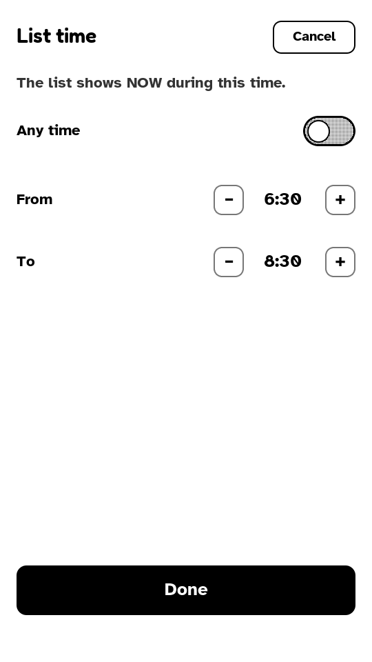
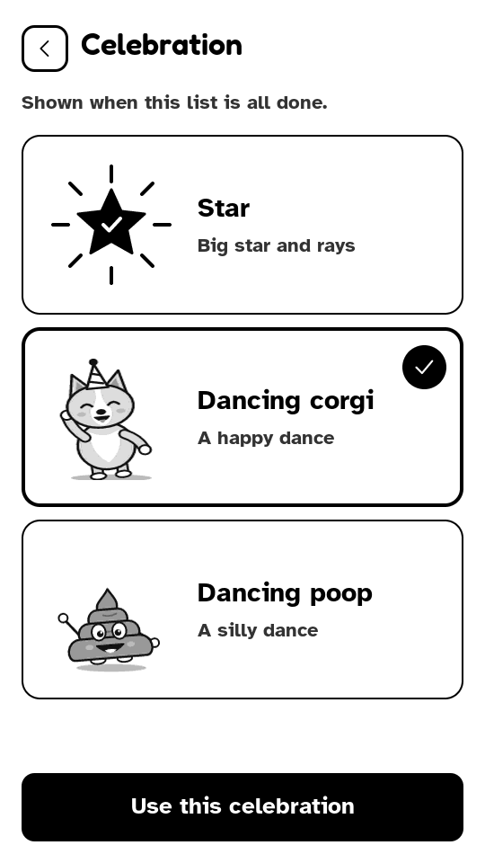

**Celebration:** tap a card to choose it (it gets a check mark), then **Use this celebration**. Remember to **Save** the list afterwards.

### Changing a task's picture
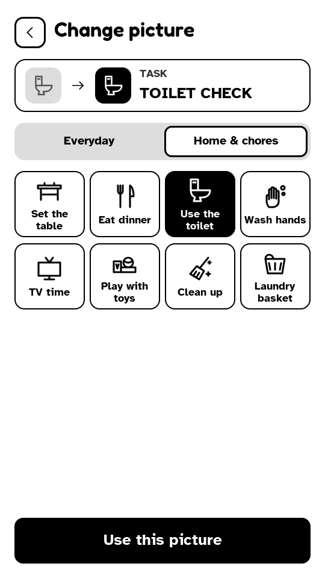

- The card at the top shows the task's current picture → the one you've picked.
- Pictures come in two groups: **Everyday** (getting dressed, teeth, breakfast, school bag, reading, music…) and **Home & chores** (set the table, dinner, toilet, wash hands, TV, toys, clean up, laundry).
- Tap a picture to select it, then **Use this picture**. Back leaves it unchanged.

 

### Adding a task
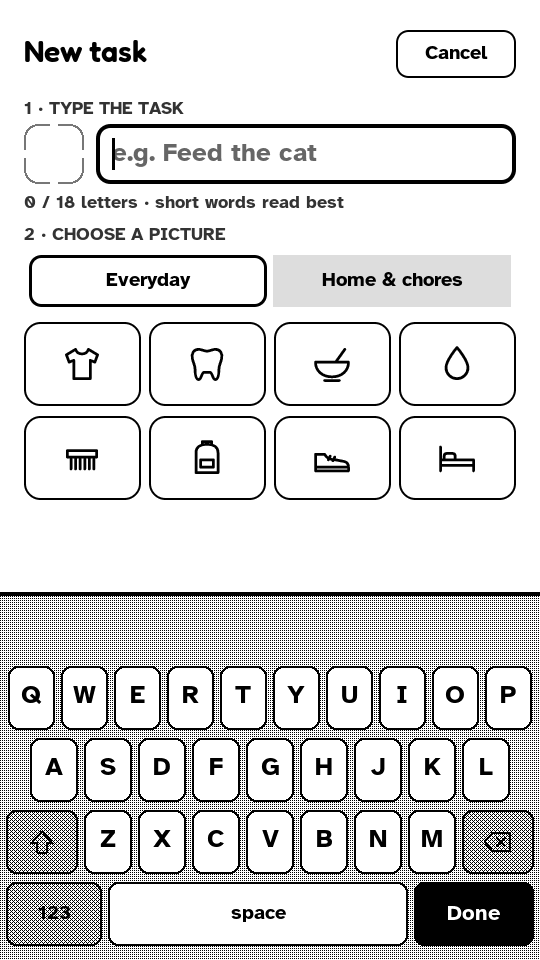

1. **Type the task** with the on-screen keyboard (up to 18 letters; short words read best).
   - The first letter is a capital automatically. **Shift** stays on until you tap it again.
   - **123** switches to numbers and punctuation.
   - Suggestions appear above the keyboard as you type ("Fe…" → "Feed the cat"); tap one to use it.
   - **Done** closes the keyboard and shows all the pictures.
2. **Choose a picture.** If the name is still empty, picking a picture fills in a suggested name (for example the toilet picture → "Use the toilet"), which you can type over.
3. Press **Add "…"**. The button tells you what's missing ("Pick a picture", "Type a task name") until both are done.

 

---

## 7. Device settings
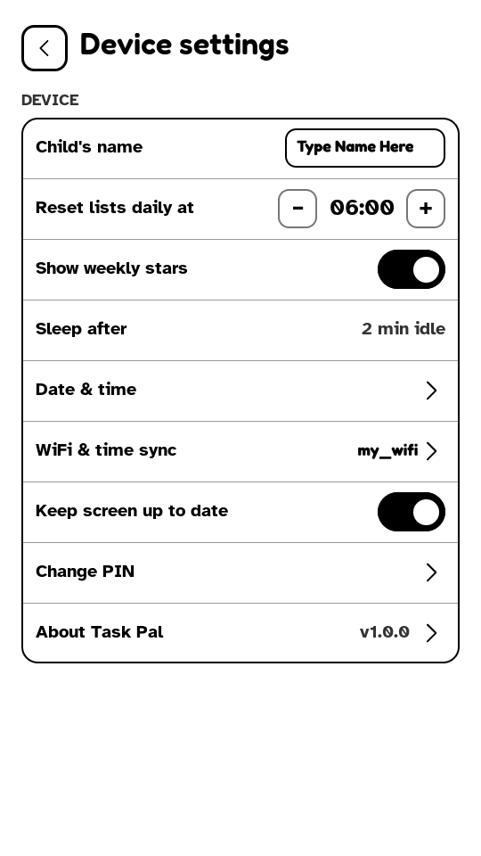

| Setting | What it does |
|---|---|
| Child's name | Shown in the greeting ("Good morning, Sam!"). Up to 12 letters. |
| Reset lists daily at | The hour when all lists start fresh (default 4:00). |
| Show weekly stars | Shows or hides "N stars this week" on Pick a list. |
| Sleep after | Fixed at 2 minutes. |
| Date & time | Set the clock by hand and choose the time zone. |
| WiFi & time sync | Set the clock from the internet. |
| Keep screen up to date | Wake from sleep when the NOW label or greeting should change (§4). On by default. |
| Change PIN | Current PIN, then the new one twice. |
| About Task Pal | Version, author, device and battery level. |

 

### Date & time
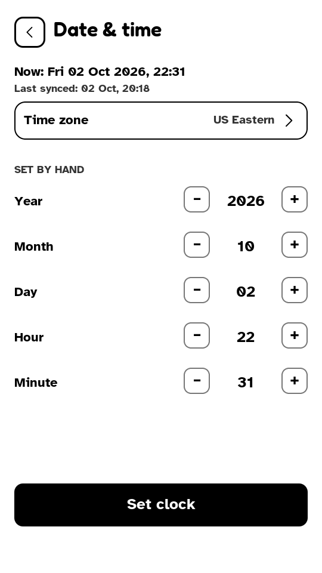

- **Time zone:** choose from the list (default US Eastern); daylight saving time is handled automatically.
- **Set by hand:** use − and + for year, month, day, hour and minute, then **Set clock**.

The device keeps time while asleep and while switched off, as long as the battery isn't completely empty.

 

### WiFi & time sync
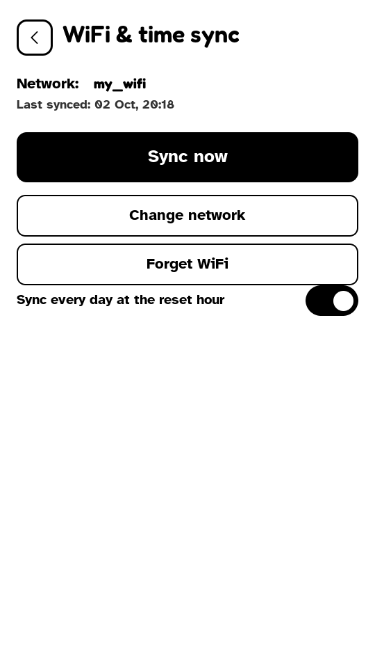

- **Change network:** pick your WiFi from the scan and type its password. The network is remembered.
- **Sync now:** sets the clock from the internet.
- **Sync every day at the reset hour:** keeps the clock accurate automatically.
- **Forget WiFi** removes the saved network.

TaskPal only uses WiFi for a few seconds to fetch the time; it doesn't send any data anywhere. If syncing fails on a mesh router in "WPA2/WPA3" mode, use a network set to plain WPA2.

 

### About
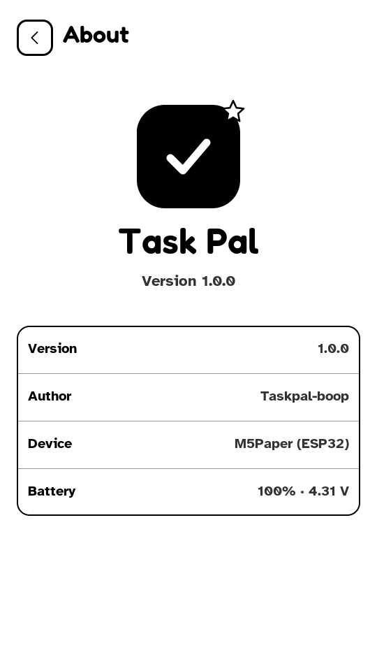

Shows the TaskPal version, author and device, and the **battery** level with its voltage. The battery value updates every 10 seconds while this screen is open.

 

---

## 8. Battery and charging
- A full charge lasts **about 4 to 5 days** of normal use (measured: 4.5 days with four short sessions a day).
- **Charge** with any USB-C charger or computer port. TaskPal keeps working while charging.
- **When the battery is nearly empty**, the screen shows **"Please charge me"** and the device switches itself off, so it keeps its clock. Plug in the USB cable, then push the side button to switch it back on.
- To check the level, open Parent area → Device settings → **About Task Pal**. The percentage is an estimate from the battery voltage; it drops slowly at first and faster near the end.

---

## 9. Troubleshooting

| Problem | What to do |
|---|---|
| The screen doesn't react to touch or the side button | The battery is empty (on older versions it could run out without the "Please charge me" warning). Plug in USB; it starts again by itself or after a push of the side button. |
| The clock is wrong, or "not set" | Device settings → WiFi & time sync → **Sync now**, or set it under Date & time. After the battery has run completely flat, TaskPal re-syncs by itself on the next start if WiFi is set up. |
| The NOW label is on the wrong list | Check the list's **Time** in Edit list, and that the clock is right. |
| A task checked by mistake | Tap it again to uncheck it (the star goes too). |
| Forgot the PIN | See "Forgot the PIN?" in §5. |
| The screen looks garbled or stuck after a restart | The display can occasionally hang; TaskPal notices and restarts itself (you may see it redraw twice). |
| Faint traces of an earlier picture | Normal for e-ink; they disappear at the next full screen change. |
